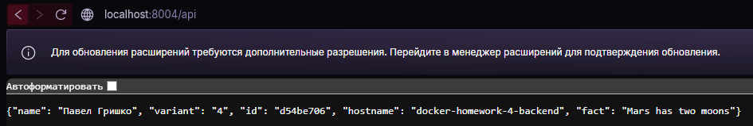

\# Отчёт docker-homework-4


Вариант 4, порт 8004, ID: d54be706


\## Схема


```

curl -> localhost:8004 -> frontend (nginx) --/api--> backend:5000 -> volume /data/fact.txt

&#x20;         все в сети docker-homework-4

```


Multi-stage не нужен, т.к. ничего не компилируется (python и nginx).


\## Проверки


```

curl http://localhost:8004/api

{"name": "Павел Гришко", "variant": "4", "id": "d54be706", "hostname": "docker-homework-4-backend", "fact": "Light from the Sun reaches Earth in about 8 minutes"}


docker ps

docker-homework-4-frontend   (healthy)   0.0.0.0:8004->80/tcp

docker-homework-4-backend    (healthy)   5000/tcp


docker port docker-homework-4-backend

(пусто)


curl http://localhost:5000/

Failed to connect


docker stats --no-stream

docker-homework-4-frontend   16.05MiB / 64MiB

docker-homework-4-backend    13.78MiB / 128MiB

docker stats --no-stream

docker-homework-4-frontend   16.05MiB / 64MiB

docker-homework-4-backend    13.78MiB / 128MiB

```


Сеть: оба контейнера в docker-homework-4, nginx ходит по имени `backend`.


Volume: записал в файл "Mars has two moons", удалил backend, запустил start.sh - в /api осталось "Mars has two moons".


\## Неисправность: volume не по тому пути


Запустил backend с `-v docker-homework-4-data:/app/data`.


Симптом: /api отдаёт 500 `file not found /data/fact.txt`, backend unhealthy.


Гипотезы:

1\. проблема с сетью

2\. файл удалён

3\. volume не в той папке


Проверки:

\- `docker logs` - запрос от frontend дошёл, значит сеть работает

\- `ls /data` в volume - файл на месте

\- `docker inspect` Mounts - `"Destination":"/app/data"`


Причина: volume в /app/data, а приложение читает /data.


Исправление: перезапустил start.sh с /data. После этого /api отдаёт 200, backend healthy.


\## Решения


1\. alias `backend` - короче и не зависит от имени контейнера

2\. healthcheck читает файл - видно, если volume сломан

3\. backend не от root - так безопаснее


\## Недостаток


nginx запоминает IP backend при старте. Если пересоздать только backend, frontend его потеряет. Можно исправить через `resolver 127.0.0.11` в nginx.


## Скриншот


