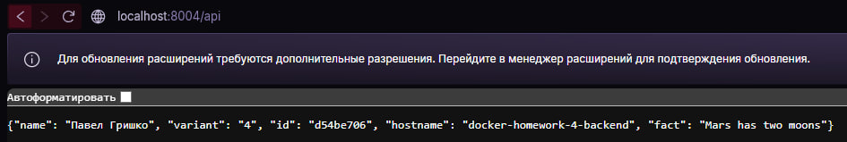

# Отчёт docker-homework-4

Гришко Павел, вариант 4, порт 8004, ID: d54be706 (сделал один раз через `cat /proc/sys/kernel/random/uuid | cut -c1-8`, лежит в project.env)

## Схема

```
браузер/curl
    |
    | localhost:8004
    v
+------------- сеть docker-homework-4 (bridge) -------------+
|                                                            |
|  frontend (nginx :80) ---- /api ---->  backend (python)   |
|  8004 -> 80                            :5000, alias backend|
|                                        наружу не торчит    |
+------------------------------------------|-----------------+
                                           |
                             volume docker-homework-4-data
                                   /data/fact.txt
```

frontend: nginx:1.27-alpine, лимиты 0.25 CPU / 64 MB.
backend: python:3.12-alpine, лимиты 0.5 CPU / 128 MB, работает не от root.
Образы `docker-homework-4-frontend:v4` и `docker-homework-4-backend:v4`.

Backend отдаёт JSON: имя, вариант, ID, hostname и поле `fact` - факт про космос из файла в volume.

Multi-stage не нужен, т.к. ничего не компилируется: python запускает app.py как есть, nginx просто отдаёт статику.

## Проверки

Всё снято скриптом `scripts/collect.sh`, полный вывод в `checks.txt`. Тут только нужные куски.

/ и /api:

```
curl http://localhost:8004/
HTTP 200
<h1>docker-homework-4</h1>

curl http://localhost:8004/api
HTTP 200
{"name": "Павел Гришко", "variant": "4", "id": "d54be706", "hostname": "docker-homework-4-backend", "fact": "Light from the Sun reaches Earth in about 8 minutes"}
```

docker ps, backend без опубликованного порта, healthcheck:

```
docker ps
NAMES                        IMAGE                           STATUS                   PORTS
docker-homework-4-frontend   docker-homework-4-frontend:v4   Up 5 minutes (healthy)   0.0.0.0:8004->80/tcp, [::]:8004->80/tcp
docker-homework-4-backend    docker-homework-4-backend:v4    Up 5 minutes (healthy)   5000/tcp

docker port docker-homework-4-backend
(пусто)

curl http://localhost:5000/
exit code 7 (не подключиться)

/docker-homework-4-frontend healthy FailingStreak=0
/docker-homework-4-backend healthy FailingStreak=0
```

У backend в PORTS только `5000/tcp`, `docker port` пустой, с хоста на 5000 не достучаться.

Сеть:

```
docker network inspect docker-homework-4
docker-homework-4 driver=bridge
  docker-homework-4-backend 172.18.0.2/16
  docker-homework-4-frontend 172.18.0.3/16
aliases backend: ["backend"]

docker exec docker-homework-4-frontend wget -qO- http://backend:5000/health
{"status": "ok"}
```

Оба в docker-homework-4, у backend alias `backend`, frontend ходит к нему по имени.

Лимиты:

```
/docker-homework-4-frontend NanoCpus=250000000 Memory=67108864
/docker-homework-4-backend NanoCpus=500000000 Memory=134217728

docker stats --no-stream
NAME                         CPU %     MEM USAGE / LIMIT
docker-homework-4-frontend   0.00%     15.58MiB / 64MiB
docker-homework-4-backend    0.01%     14.86MiB / 128MiB
```

250000000 это 0.25 CPU, 500000000 это 0.5 CPU, 67108864 и 134217728 это 64 и 128 MB. В stats лимит памяти тоже видно.

Volume. Поменял факт на "Mars has two moons", удалил backend и создал заново (frontend не трогал):

```
docker exec -u 0 docker-homework-4-backend sh -c 'echo "Mars has two moons" > /data/fact.txt'
{"name": "Павел Гришко", ..., "fact": "Mars has two moons"}
backend id до: 2387809948c6

docker rm -f docker-homework-4-backend
bash scripts/start.sh backend
waiting for docker-homework-4-backend healthcheck........ healthy
backend id после: e5af9b294d95

curl http://localhost:8004/api
HTTP 200
{"name": "Павел Гришко", "variant": "4", "id": "d54be706", "hostname": "docker-homework-4-backend", "fact": "Mars has two moons"}
```

id контейнера поменялся, а факт остался - значит данные лежат в volume.

## Неисправность: volume не по тому пути (4 % 4 = 0)

Сломал так:

```
DATA_MOUNT=/app/data bash scripts/start.sh backend
```

**Симптом:** главная открывается, а /api отдаёт 500 `file not found /data/fact.txt`, backend стал unhealthy.

```
waiting for docker-homework-4-backend healthcheck........................ unhealthy

curl http://localhost:8004/api
HTTP 500
{"error": "file not found /data/fact.txt"}

docker ps -a
NAMES                        STATUS
docker-homework-4-backend    Up 30 seconds (unhealthy)
docker-homework-4-frontend   Up 5 minutes (healthy)
```

**Гипотезы:**

1. frontend не видит backend (сеть или имя)
2. файл пропал из volume
3. volume подключён не туда

**Проверки:**

Логи backend - запрос доходит, падает на чтении файла:

```
docker logs --tail 4 docker-homework-4-backend
file not found: /data/fact.txt
172.18.0.3 - - [24/Nov/2026 12:24:04] "GET / HTTP/1.0" 500 -
172.18.0.3 - - [24/Nov/2026 12:24:04] "GET / HTTP/1.0" 500 -
file not found: /data/fact.txt
```

172.18.0.3 это frontend, т.е. запросы от него до backend доходят.

1 - оба контейнера в сети, frontend по имени `backend` получает ответ (500, но ответ есть). Сеть ок:

```
docker network inspect docker-homework-4 (контейнеры)
docker-homework-4-backend docker-homework-4-frontend

docker exec docker-homework-4-frontend wget -qO- http://backend:5000/
wget: server returned error: HTTP/1.0 500 Internal Server Error
```

2 - смотрю volume отдельным контейнером, файл на месте. Тоже не то:

```
docker run --rm -v docker-homework-4-data:/data docker-homework-4-backend:v4 ls -l /data
-rw-r--r--    1 root     root            19 Nov 24 12:23 fact.txt
... cat /data/fact.txt
Mars has two moons
```

3 - volume смонтирован в /app/data, в /data пусто:

```
docker inspect docker-homework-4-backend (Mounts)
docker-homework-4-data -> /app/data
ls /data:
ls /app/data:
fact.txt
```

Порт frontend проброшен нормально, 500 приходит от backend через nginx:

```
80/tcp -> 0.0.0.0:8004
80/tcp -> [::]:8004

> GET /api HTTP/1.1
< HTTP/1.1 500 Internal Server Error
```

**Причина:** гипотеза 3. Volume в /app/data, а app.py читает /data/fact.txt.

**Исправление:** пересоздал backend с `-v docker-homework-4-data:/data`:

```
bash scripts/start.sh backend
waiting for docker-homework-4-backend healthcheck........ healthy
```

**Повторная проверка:**

```
HTTP 200
HTTP 200
{"name": "Павел Гришко", "variant": "4", "id": "d54be706", "hostname": "docker-homework-4-backend", "fact": "Mars has two moons"}
NAMES                        STATUS                    PORTS
docker-homework-4-backend    Up 10 seconds (healthy)   5000/tcp
docker-homework-4-frontend   Up 6 minutes (healthy)    0.0.0.0:8004->80/tcp, [::]:8004->80/tcp
docker-homework-4-data -> /data
```

## Решения

1. **alias `backend` + resolver в nginx.** nginx ходит на `backend:5000`, а не на имя контейнера. Сначала был обычный `proxy_pass http://backend:5000/`, и nginx запоминал IP backend при старте - если пересоздать только backend, frontend отдавал 502. Добавил `resolver 127.0.0.11` (DNS докера) и адрес через переменную. Теперь backend можно пересоздавать сколько угодно, это видно выше: frontend "Up 6 minutes", а backend за это время пересоздавался несколько раз.
2. **healthcheck читает файл.** `/health` сначала открывает fact.txt, так что если volume отвалился или не туда смонтирован - контейнер unhealthy. На поломке это сразу видно в `docker ps`.
3. **backend не от root.** В образе пользователь `app`, ему надо только читать файл. Первый fact.txt кладёт отдельный одноразовый контейнер от root в start.sh, и только если файла ещё нет - так повторный запуск не затирает данные.

## Недостаток

Backend на встроенном `http.server`, запросы обрабатывает по одному. Если один подвиснет, остальные и healthcheck будут ждать. Можно заменить `HTTPServer` на `ThreadingHTTPServer` (одна строчка) или запускать через gunicorn.

## Скриншот

